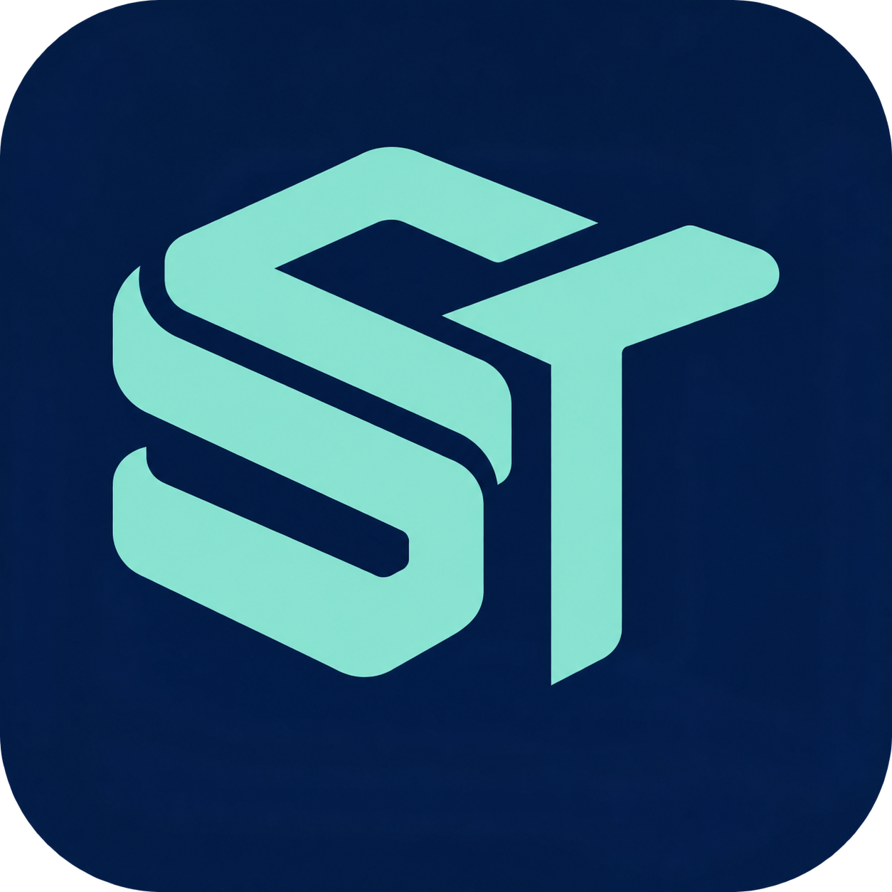

# SomesToken



**Free, local token-usage reports for Codex and Claude Code.** Created and maintained by [Somestr](https://github.com/somestr). MIT licensed, with no paid tier.

SomesToken records the token usage that Codex and Claude Code already expose. It reports that usage by task, model, reasoning effort, main agent and subagents, cache use and account quota observations. Everything runs on your machine, and reports appear only when you ask for them.

SomesToken measures usage. It does not claim to save tokens, quota or money. Savings are not measured, and in our trials so far its optional efficiency guidance has not measurably reduced cost. If verified savings are ever established, this README will state them together with the evidence.

## What you can rely on

- **Usage by task.** Once you opt in (see [Install](#install)), each task's usage is split by model, reasoning effort, main agent and subagents, cache reads and writes, with account quota windows shown separately. Quota is shared by the whole account, so tasks get token shares, never quota shares.
- **Honest labels.** Every figure is `exact`, `partial`, `pending` or `unavailable`. Missing data never becomes zero. Prices are calculated from published rates and are not bills.
- **Local and private.** Hooks and reports make no model calls, send no telemetry and upload nothing, and there is no web dashboard. See [Privacy](#privacy) for the two places where more than numbers is kept locally.
- **Read-only reporting.** Reports never change a model, reasoning effort, plan, permission or task. The one part that edits files is the `somestoken-code` skill described below, and only for code changes you ask for.
- **Bounded.** The workspace store and Claude's numeric feed are capped at 64 MiB each. Hooks do bounded work: a Claude hook parses at most 64 MiB of new transcript and leaves larger catch-up work to the background collector. A Claude turn receipt needs the whole transcript within 64 MiB, so in a longer session turn receipts are `unavailable`; with the Claude opt-in, the collector still records its usage.

These points are covered by a private automated test suite that uses synthetic data and by daily use on the maintainer's Mac (macOS, Apple silicon). Other machines have not been verified.

## What the plugin adds

- **Hooks** in Codex and Claude Code that record each turn's usage as it completes.
- **A read-only reporting tool** (MCP) and the `somestoken` skill, which answers usage questions.
- **`somestoken-quota-handoff`**, off by default: quota notices and, if you choose, a progress note before a limit.
- **`somestoken-code`**: your agent may use this skill for code review and refactoring requests in Swift, Python, Go, Java, JavaScript or TypeScript. A review only reports findings. For a change, the skill wraps the edit in two commands that run your project's tests. The edit stays only when the tests pass; otherwise the skill restores the files it was asked to change. Its working state lives under `.git/somestoken-change/`.

## What it does not promise

- **Savings.** Fewer tokens, less quota or lower cost are not claimed.
- **Bills.** Calculated prices are estimates from published rates, not invoices.
- **Forecast accuracy.** Forecasts are experimental until enough of your own completed tasks calibrate them.
- **Other platforms.** Only macOS on Apple silicon is validated. Linux and Windows are not verified.
- **Other hosts.** Only Codex (Desktop and CLI) and Claude Code are supported.
- **Unlimited history.** At most 100,000 responses or 90 days are kept; the oldest go first.
- **Effortless Codex updates.** Codex 0.164 asks you to approve SomesToken's 11 hooks again after every install or update. The Codex desktop app can skip changed hooks without offering a way to approve them ([openai/codex#37362](https://github.com/openai/codex/issues/37362)); approve them in the Codex CLI instead: run `codex`, open `/hooks`, approve and quit.

## Requirements

- macOS (validated on Apple silicon).
- Node.js 24 or newer.
- Codex Desktop or CLI, Claude Code, or both.
- No `npm install`: the runtime has no dependencies.

## Install

```sh
git clone https://github.com/somestr/SomesToken-Public.git SomesToken
cd SomesToken
npm run build
```

Keep the folder on your startup disk, outside Desktop, Documents and Downloads (your home folder works): the background collector runs from it, and macOS can deny background jobs access to those places.

**Codex:**

```sh
npm run setup -- --check
npm run setup -- --apply
```

Approve the SomesToken hooks in Codex (`/hooks`) and enable the plugin when prompted, then run:

```sh
npm run setup -- --verify
```

**Claude Code:**

```sh
claude plugin marketplace add ./
claude plugin install somestoken@somestoken-local --scope user
```

**Task history (macOS, both hosts):** task lists, daily totals and quota windows come from a background collector that runs every 30 seconds. It reads your session history only after you opt in for each host you use. Then install it once:

```sh
node plugins/somestoken/bin/report.mjs --enable-codex-ledger="$HOME/.codex/sessions"   # Codex
node plugins/somestoken/bin/report.mjs --enable-claude-feed                          # Claude Code
npm run setup -- --collector
```

Without these steps, the hooks still record each turn's usage. The [setup guide](docs/setup.md) covers the collector, verification, updates and removal.

## Use

In Codex, mention `@SomesToken`, for example: `@SomesToken what did this task use?` In Claude Code, ask for a SomesToken report; the plugin's skill answers through its read-only reporting tool.

From a terminal in the SomesToken folder:

```sh
node plugins/somestoken/bin/report.mjs --diagnostics --json
node plugins/somestoken/bin/report.mjs --summary
node plugins/somestoken/bin/console.mjs --view=tasks
```

## Privacy

Hooks and reports make no model calls, send no telemetry and upload nothing. The collector asks the locally installed Codex app-server for account quota, and Codex may contact OpenAI to answer. SomesToken does not call a billing API or scrape a dashboard.

With your opt-in, the collector reads Codex's saved sessions and Claude Code's transcripts (`~/.claude/projects`) to extract usage numbers; it does not copy them. Stored reports keep counters, timestamps, model names, fixed reason codes and hashed identities. They exclude prompts, responses, reasoning, source code, diffs, tool output, secrets, raw transcripts, working directories, absolute paths and account identifiers.

Two places keep more, and both stay on your machine:

- The collector's private source registry keeps the local paths of sessions it is allowed to read, so it can refresh them.
- Quota-handoff notes are off by default. When you turn them on, they can contain task context and local paths.

Neither appears in reports or is uploaded.

## Overhead

When nothing has changed, a collector run checks file metadata, refreshes quota and exits. On the maintainer's Mac, with history at the storage limit, a Claude hook usually takes 0.1–0.3 s and a collector pass about 10 s while sessions are active. That is one machine, not a benchmark.

## Status

Public beta. SomesToken is developed and tested in a private repository, and this repository receives tested releases. Report bugs in [Issues](https://github.com/somestr/SomesToken-Public/issues) using synthetic reproductions; never attach transcripts, usage logs or source registries. For vulnerabilities, follow the [security policy](SECURITY.md).

## License

[MIT](LICENSE). Keep the copyright notice when you redistribute SomesToken.
